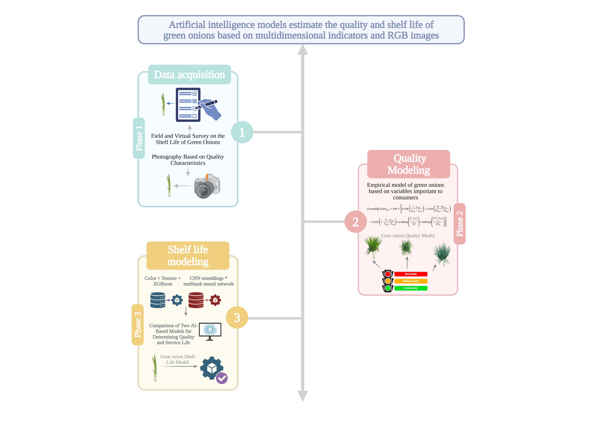

# Artificial intelligence models for quality and shelf-life estimation in green onion

Analysis notebooks for estimating the quality and shelf life of green onion (*Allium fistulosum* and hybrid) genotypes, combining consumer perception surveys with physicochemical measurements.



## Summary

Artificial intelligence models estimate the quality and shelf life of green onions from multidimensional indicators and RGB images. The work is organized in three phases:

1. **Data acquisition.** A field and virtual survey collects consumer perception of green onion shelf life, and the samples are photographed according to their quality characteristics.
2. **Quality modeling.** An empirical model, the Green Onion Quality Index (GQI), scores green onions on the attributes that consumers rated as important: pseudostem length (*L*) and diameter (*D*) as increasing min–max utilities, pseudostem hue (*h*) as a Gaussian utility, leaf hue (*h<sub>l</sub>*) as a one-sided Gaussian utility (only yellowing is penalised) and firmness (*F*) as a decreasing min–max utility, with fixed declared bounds and weights equal to the consumer importance of each attribute:

   $$\text{GQI}_{gt} = 100 \times \left[0.197\,u^{+}(L) + 0.191\,u^{+}(D) + 0.198\,e^{-\frac{(h-h^{*})^2}{2\sigma_h^2}} + 0.193\,G^{-}(h_l) + 0.222\,u^{-}(F)\right]$$

   The resulting green onion quality model sorts samples into bad, medium and good quality.
3. **Shelf-life modeling.** Models trained on photographs of the plant alone (background removed, colour corrected per session) estimate the visual class of each pseudostem, the age of a sample (days after harvest), its GQI and its remaining shelf life: scale-free colour, texture and shape descriptors with gradient boosting (**CTD-GB v2**), a frozen ResNet18 embedding with a linear head (**CNN-ridge**), and their **ensemble**, validated with whole sessions, capture days, storage times, genotypes and photo groups left out.

## Repository structure

```
├── docs/
│   ├── graphical_abstract.png             # graphical abstract (figure above)
│   └── PLAN_ANALISIS_v2.md                # Phase 3 analysis plan, fixed before any result (Spanish)
├── data/
│   ├── Phase_1_Consumer_perception.xlsx   # consumer survey responses
│   ├── Phase_2_Physicochemical.xlsx       # physicochemical traits of 406 pseudostems (GQI input)
│   └── Phase_2_GQI.xlsx                   # curated Phase 2 dataset and column dictionary
├── notebooks/
│   ├── Phase_1_Consumer_perception.ipynb  # consumer perception and acceptance analysis
│   ├── Phase_2_GreenOQ.ipynb              # GreenOQ quality index (GQI)
│   └── Phase_3_AI_models.ipynb            # Phase 3 (version 2): models on photographs of the plant alone
├── results/
│   ├── README.md                          # the headline result, the metrics and the energy summary
│   ├── figures/                           # the main result figure
│   ├── Phase3_complete_metrics.xlsx       # every Phase 3 metric in one workbook (20 sheets)
│   ├── GreenOQ_results.csv                # GQI per genotype × shelf-life time
│   └── GQI_classification.csv             # mean GQI and quality class per genotype
├── scripts/
│   ├── phase3v2_*.py                      # Phase 3 image processing, models, validation, occlusion and Word tables
│   └── build_phase3_complete_metrics.py   # merges the three Phase 3 workbooks of the previous version into one
└── requirements.txt
```

The large Phase 3 inputs (photographs, feature caches, stored validation) are not in the repository; see the Phase 3 section below.

**[→ Read the results](results/README.md)** — the headline result, the metrics of both models under the three validation protocols, and the energy cost of training and inference.

## Phase 1 — Consumer perception

`notebooks/Phase_1_Consumer_perception.ipynb` analyzes the consumer survey for ten genotypes in two modalities, always analyzed separately: **in person** (98 consumers who evaluated real samples stored 2, 6, 10 or 14 days after harvest, DAH; one independent group per time) and **online** (59 respondents who saw photographs of each genotype at the four times). The notebook follows the order of the manuscript figures:

| Figure | Analysis |
|---|---|
| 1A | Likert (1–5) ratings of five visual attributes (online, n = 59) |
| 1B | Genotype selections retained relative to 2 DAH (balanced online panel, n = 39); binomial GEE with exchangeable correlation, Bonferroni, cluster-bootstrap 95% CI |
| 1C, 1D | Sensory shelf life by **survival analysis with interval censoring** (Hough et al., 2003): survival curves per genotype, in person (1C) and online (1D); Weibull or log-normal by AIC, Turnbull estimate |
| 1E | Stated purchase decision per genotype (No / Maybe / Yes, online, n = 59) |
| 1F | t50 (day at which 50% of consumers reject) per genotype and modality with 95% bootstrap CI |
| 2A–2T | Per genotype: word cloud of the open answers (analyzed in Spanish, manual glossary to English, negation marked, terms in ≥ 2 answers) and survival curve with censored observations and 95% CI band |
| S1a, S1b | n per modality after quality filters, and origin of the online respondents |

Quality filters (straight-lining, IQR outliers, low agreement with the majority) leave 95 in-person consumers and an online balanced panel of 39. Every random step uses a fixed seed, so the notebook reproduces the same numbers and figures on every run. Figures are shown only inside the notebook (nothing is written to disk).

Input: `data/Phase_1_Consumer_perception.xlsx`, with three sheets (original Spanish names):

| Sheet | Modality | Content |
|---|---|---|
| `Preguntas por material` | online | origin, Likert ratings, and per genotype: *would you buy it?*, *why?* (open text) and *when would you stop buying it?* |
| `Preguntas en vida util` | online | genotypes the respondent would buy at each time T1–T4 (2, 6, 10, 14 DAH), as material numbers 1–10 |
| `Vida util Genotipos` | in person | storage time evaluated and, per genotype, *would you buy it?* (yes/no) with the real sample |

## Phase 2 — Green Onion Quality Index (GQI)

`notebooks/Phase_2_GreenOQ.ipynb` builds a 0–100 index of the **commercial quality** of green onion (commercial size + freshness), following the ten steps of the OECD/JRC (2008) handbook on composite indicators; each step is a section of the notebook.

| Variable | Symbol | Unit | Utility | Fixed parameters | Weight |
|---|---|---|---|---|---|
| Pseudostem length | L | cm | increasing min–max | 15–30 cm | 19.7 % |
| Pseudostem diameter | D | mm | increasing min–max | 5–23 mm | 19.1 % |
| Pseudostem hue | h | ° | Gaussian | h* = 102.9°, σ = 16.0° | 19.8 % |
| Leaf hue | h<sub>l</sub> | ° | one-sided Gaussian | h<sub>l</sub>* = 124.1°, σ = 5.2° | 19.3 % |
| Firmness (puncture force) | F | N | decreasing min–max | 3–30 N | 22.2 % |

- **Variable selection**: consumer importance ≥ 50 %, measured at the four storage times and significant change between genotypes or over storage. Leaf length (29 % importance) is excluded.
- **Weights**: consumer importance from the published survey (A) and the Phase 1 survey (B). PCA is used only to check the structure of the variables, not to weight them.
- **Fixed bounds**: adding or removing genotypes does not change the GQI of the others.
- **Robustness**: alternative weights, leaving one variable out, observed bounds, geometric aggregation and 10 000 random weight vectors.
- **External validation**: linear mixed model (genotype as random effect), ROC against the consumer shelf life of each genotype compared with storage time alone, and correlation with declared (online) and observed (in-person) consumer acceptance, with bootstrap over genotypes.

The pseudostem diameter is labelled "(cm)" in the source sheet, but its values (5.0–23.0) are only plausible in mm; the notebook treats it as mm.

Inputs (in `data/`): `Phase_2_Physicochemical.xlsx` (sheet `Sheet1`, 406 pseudostems) and `Phase_1_Consumer_perception.xlsx` (validation). Outputs (in `results/`): `GreenOQ_results.csv` and `GQI_classification.csv`.


## Phase 3 — Models on photographs of the plant alone (version 2)

`notebooks/Phase_3_AI_models.ipynb` is a re-analysis from the original photographs that answers the review of the first version. Its analysis plan (models, hyperparameters, protocols, metrics and references) was fixed before any result was seen and is reproduced at the top of the notebook, together with every later change and its reason (`docs/PLAN_ANALISIS_v2.md`).

**What the photograph estimates.** The visual class of each pseudostem (On-Grade, Minor defects, Major defects, Decay) is the only label that belongs to the photographed pseudostem. Storage time (days after harvest, DAH), GQI and remaining shelf life belong to the genotype × time cell, because the laboratory analyses were destructive and made on other plants; they are evaluated per cell and always against references that use only the storage days or the genotype.

**Image processing** (`scripts/phase3v2_common.py`, `phase3v2_images.py`). For each of the 16,396 photographs the plant is segmented on the table (background modelled by a quadratic surface; shadows, reflections, walls, labels, background trays and objects removed), colour-corrected per session with the table as a neutral reference, aligned along its main axis and normalised to a fixed length, since there is no scale reference. The models never see the background.

**Models** (`phase3v2_models.py`):
- **CTD-GB v2**: 99 scale-free colour, texture and shape descriptors of the plant with histogram gradient boosting.
- **CNN-ridge**: a frozen ResNet18 embedding of the plant crop with ridge or multinomial logistic regression.
- **Ensemble** of both (the main model).

**Validation** (`phase3v2_validation.py`) leaves out whole units:
- P1: genotype × time blocks, with five repetitions;
- P1 by capture day;
- P2: one storage time;
- P3: one genotype — the generalization result;
- P4: one of the two photo groups (five genotypes photographed on their own days), i.e. unseen genotypes and photo days.

Every protocol is compared with trivial, DAH-only, genotype-only and genotype + DAH references, with 95% confidence intervals by cluster bootstrap. The notebook also reports split-conformal prediction intervals, the accept/reject decision against a fixed days rule with cost curves, a leakage ladder from random photographs to unseen genotypes, and occlusion maps (`phase3v2_occlusion.py`).

### Data

Point `GREEN_ONION_DATA` at the folder with `dataset_final.csv` and `cache/` (`photo_metadata.csv`, `tramos.csv` and the stored results of the previous version), and `GREEN_ONION_V2` at the folder with the version-2 caches: `features_v2.npz`, `meta_v2.csv`, `crops.npy`, `examples_v2.npz`, `validation_v2.pkl`, `ladder_v2.pkl`, `occlusion_v2.npz` and `tables_v2.pkl`. They are not in the repository because of their size. The notebook only reads these caches and runs in a few minutes.

To rebuild the caches from the photographs, set `GREEN_ONION_PHOTOS` to the folder that contains `T1`–`T4`, add `scripts/` to `PYTHONPATH`, and run, in order:
1. `phase3v2_images.py` (about 1.5 h on 7 CPU processes);
2. `phase3v2_embed.py` (about 50 min);
3. `phase3v2_examples.py`;
4. `phase3v2_validation.py validation_v2.pkl` (about 3 h; each fold is saved and the run resumes if interrupted);
5. `phase3v2_validation.py ladder_v2.pkl --ladder`;
6. `phase3v2_occlusion.py`.

`phase3v2_tables_docx.py` writes the tables in English to a Word file.

## How to run

```bash
pip install -r requirements.txt
jupyter lab   # or open the notebooks in VS Code
```

The notebooks can be run from the repository root or from `notebooks/`; paths are resolved relative to the repository. Figures use Times New Roman, which must be installed on the system.

Source spreadsheets keep their original Spanish sheet names, column names and answer labels (e.g. `Genotipo`, `Tiempo`, `Tal vez`, `Sí`); the notebooks refer to them as-is.
